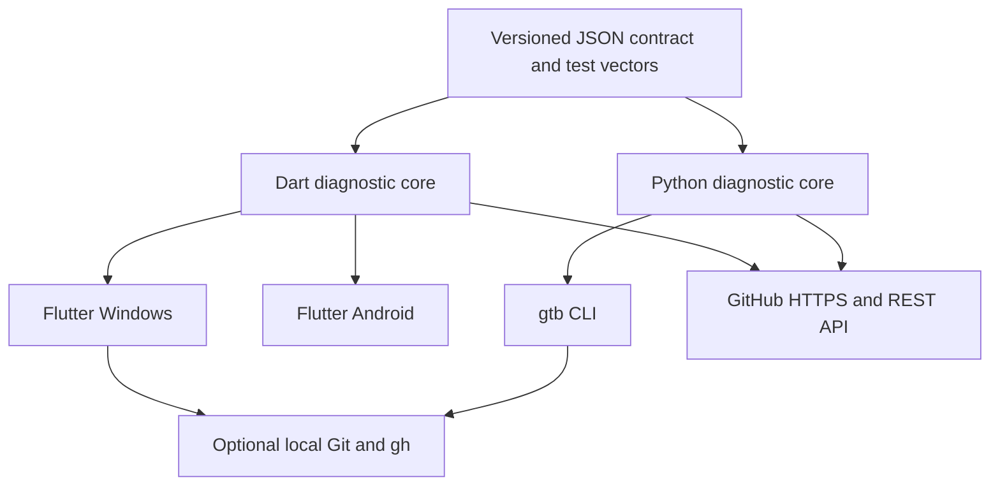

# GITHUB TEST BUTTON

**One button to understand GitHub connectivity.**

GTB is a Windows and Android diagnostic application with an independent Python command-line package. It separates network reachability, authentication, repository read access, and verified write operations. Public diagnostics work without an account or Codex.

Initial engineering version: **0.1.0-beta.1**. Consult [build verification](docs/BUILD-VERIFICATION.md) and [known limitations](reports/KNOWN-LIMITATIONS.md) for the evidence boundary of this release.

## Downloads

Download packaged builds from [GitHub Releases](https://github.com/chatgptopenaiagi/GITHUB-TEST-BUTTON/releases). Verify downloads against the release's `SHA256SUMS.txt`.

| Platform | Artifact | Instructions |
|---|---|---|
| Windows x64 | `GTB-Windows-Setup.exe` or complete portable ZIP | [Windows](docs/WINDOWS-INSTALLATION.md) |
| Android ARM64 | `GTB-Android-arm64.apk` | [Android](docs/ANDROID-INSTALLATION.md) |
| Python 3.10+ | `github_test_button-0.1.0b1-py3-none-any.whl` | [CLI](docs/PYTHON-CLI.md) |

## What the button checks

Network availability, DNS, GitHub HTTPS, REST API, a public account, service health, request latency, authentication when configured, rate limits, and relevant local tools. Every result carries its own status. Missing optional tools do not make a successful GitHub API connection fail.

The ordinary test is read-only. The separate write test needs an explicit target and confirmation, creates a unique branch or a requested private test repository, commits a generated verification file, pushes, and compares API readback. It never deletes repositories.

## Python quick start

```console
python -m pip install github_test_button-0.1.0b1-py3-none-any.whl
gtb test --json
gtb doctor
gtb auth status
gtb repo check chatgptopenaiagi/GITHUB-TEST-BUTTON
gtb --help
```

## Architecture



Dart and Python are separate implementations tested against common meanings and fixtures. Android networking is independent of the Windows machine.

## Development

See [architecture](docs/ARCHITECTURE.md), [diagnostic model](docs/DIAGNOSTIC-MODEL.md), [authentication](docs/GITHUB-AUTHENTICATION.md), [repository operations](docs/REPOSITORY-OPERATIONS.md), [security](docs/SECURITY-AND-PRIVACY.md), and [build verification](docs/BUILD-VERIFICATION.md). Build scripts under `scripts/` check prerequisites and stop on failed native commands. CI builds platform artifacts independently.

GTB is an independent utility and is not affiliated with GitHub or OpenAI. GitHub is a trademark of its owner.
