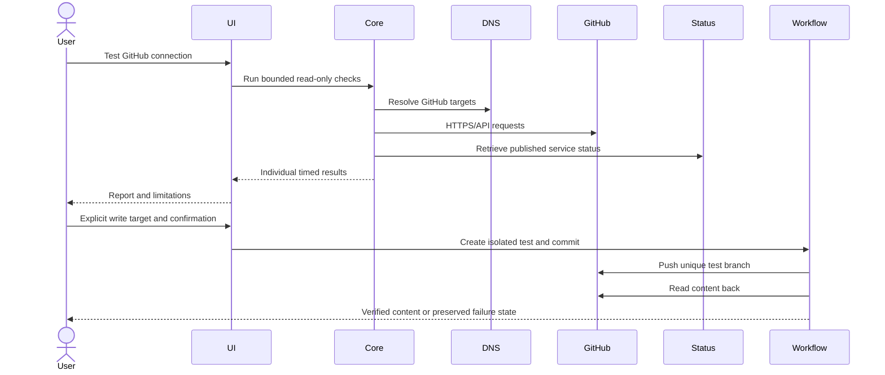

# Product architecture

Flutter owns the Windows/Android interface and a Dart diagnostic core. Python owns an independently installable CLI with its own implementation. The two surfaces exchange no executable runtime; their shared boundary is `contracts/`.

Each report contains application/version identity, schema version, platform, timestamp, aggregate status and individual timed checks. Diagnostic IDs and status classifications are stable contract elements. Evidence of tool discovery is separate from evidence of a functional operation. Repository writes are separate explicit workflows.

No backend service or developer computer is needed for Android public diagnostics. A future mobile OAuth broker is a separate deployment requirement, not an existing capability.
