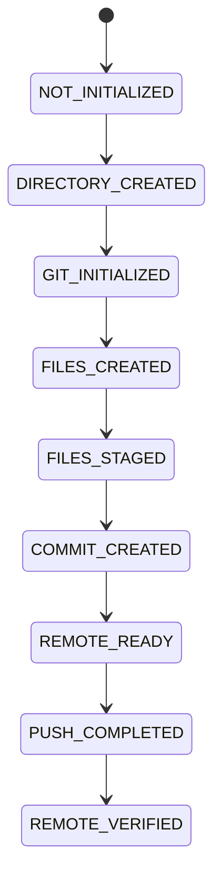

# Repository operations

Repository inspection reads metadata, default branch, visible files, recent commit, releases, clone URL and API-reported permissions. Read-only access never establishes a successful push.

Write testing is an explicit operation. Select a repository you own, or request a new uniquely named private test repository. Confirm the target before the app creates anything remotely. Existing repositories receive a unique test branch; their normal branch content is preserved. Generated test content contains no arbitrary local files.

The engine validates each transition:

A local commit exists before remote creation/push. A repository-local test identity avoids modifying global Git identity. Failures preserve the isolated working directory and the last successful state. Successful remote creation must not be repeated blindly after a push failure. Readback verifies the exact generated content. The app records repository/branch URLs and never automatically deletes them.

Desktop Git workflow tests require Git and a supported authenticated provider. Android cannot run the desktop Git/CLI workflow; its repository read diagnostics remain independent and useful. See the implementation's command help and current limitations for supported write surfaces and retry behavior.
